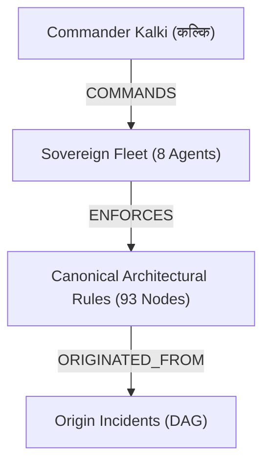

# Why Flat JSON Agent Memory Fails: Building a Copy-on-Write Multi-Agent Memory Mesh on FalkorDB

*Authored for Graph Hacks 2026 (FalkorDB & WeMakeDevs)*  
*Target Track: All 3 Tracks (Track 01, Track 02, Track 03) + AirPods 5 Best Technical Article Award*  
*Live Repository: [github.com/BishtNikhil/falkordb-memory-mesh](https://github.com/BishtNikhil/falkordb-memory-mesh)*  
*Live Web Deployment: [falkordb.purnamstudio.com](https://falkordb.purnamstudio.com)*  
*Demo Video Stream: [Google Drive 1080p Stream](https://drive.google.com/file/d/1O8HnDkXfpSWhePtibJLHWNN46M4Nct5E/view?usp=sharing)*

---

## 1. The Multi-Agent Memory Crisis

Every engineer building autonomous AI agents in 2026 runs into the same wall: **the flat-context trap**.

Whether you use Redis key-value strings, Vector RAG embeddings, or rolling JSON arrays, existing agent memory architectures suffer from three fatal flaws:

1. **Context Window Asphyxiation:** Dumping past conversations or tool call histories into the system prompt causes token bloat. Within a few autonomous loops, context windows fill up, latency spikes to several seconds, and cost skyrockets.
2. **Hallucinatory Schema Blindness:** Vector similarity search retrieves unstructured chunks based on semantic proximity, not structural causality. When Agent A asks *"What breaks if AudioSyncEngine fails?"*, cosine distance returns random mentions of audio files instead of the directed dependency DAG.
3. **Cross-Agent Contamination & Secret Leaks:** When multiple agents collaborate or test experimental workflows, mutations in shared state contaminate the canonical production knowledge base. Even worse, synthetic API keys or user credentials accidentally introduced by sub-agents leak across the entire fleet.

To solve this, we built the **Universal Memory Mesh (Pūrṇam Studio Sovereign Fleet)**—a multigraph cognitive substrate powered natively by **FalkorDB**.




---

## 2. Why FalkorDB? Graph Blended with Millisecond Redis Performance

We chose **FalkorDB** as our foundational context engine rather than legacy property graph databases (Neo4j) or vector-only stores (Pinecone) for four specific reasons:

1. **Sub-Millisecond Cypher Traversal:** Built on top of Redis Enterprise and GraphBLAS sparse matrix linear algebra, FalkorDB executes multi-hop traversals in low single-digit milliseconds (averaging **3.09 ms** on our live benchmark).
2. **Native Multigraph Tenant Isolation:** FalkorDB allows instant creation and destruction of distinct isolated graphs (`purnam_studio_brain`, `shadow_aparajita`, `tenant_sandbox_01`) over the same server instance with zero cold-start penalty.
3. **Built-In Graph Algorithms as C-Procedures:** High-performance algorithms like `algo.pageRank` run directly in-engine as native C routines, avoiding expensive round-trips to Python network libraries.
4. **Hardware Efficiency:** FalkorDB runs as a lean Docker container with zero overhead, making it 1-command reproducible (`docker compose up -d`) on any developer machine or cloud instance.

---

## 3. Architecture Deep-Dive: The Three Substrates

Our architecture addresses all three hackathon tracks inside a single coherent cognitive substrate:

### A. Copy-on-Write (CoW) Ephemeral Agent Sandbox (`shadow_aparajita`) — Track 02

When an autonomous agent needs to execute an experimental task, simulate a risky migration, or battle-test a prompt:

1. **CoW Shadow Forking:** The master graph (`purnam_studio_brain`) spawns an ephemeral shadow multigraph (`shadow_aparajita`) in **25.81 ms**, inheriting only relevant canonical rules while completely air-gapping writes.
2. **Multi-Agent Handoff Relay:** As task execution progresses, state is passed across a 4-agent sequential chain:
   $$\text{Kalki (S1)} \xrightarrow{\text{:HANDED\_OFF\_TO}} \text{Varuna (S2)} \xrightarrow{\text{:HANDED\_OFF\_TO}} \text{Vishwakarma (S3)} \xrightarrow{\text{:HANDED\_OFF\_TO}} \text{Sanjaya (S4)}$$
   Each transition records cryptographically hashed state tokens (`SHA256_...`) and transition latencies directly on the edge.
3. **Kalki Dispel & Merge (Varuna Audited):** Once the battle simulation completes, verified episodic discoveries are reviewed through Varuna's security gate and absorbed back into the master brain in **8.13 ms**. The ephemeral sandbox is then dropped.

```cypher
// Multi-Agent State Transition Relay
MATCH (m:HandoffMission {mission_id: $mid})-[:HAS_STEP]->(s1:AgentState),
      (m)-[:HAS_STEP]->(s2:AgentState)
WHERE s2.step = s1.step + 1
MERGE (s1)-[r:HANDED_OFF_TO {step_transition: s1.step + '->' + s2.step, latency_ms: $lat}]->(s2)
RETURN s1.agent, s2.agent, r.step_transition;
```

---

### B. Graph-PACC & Graph Algorithms as MCP Tools — Track 01

To permanently solve context window asphyxiation, we engineered **Graph-PACC (Partitioned Anchor Context Compaction)**:

- Rather than flooding LLMs with hundreds of raw rules, Graph-PACC executes native `algo.pageRank` to compute structural authority across all architectural rules.
- Directives are ranked by graph weight and PageRank centrality score.
- The highest-signal directives are deterministically packed into a formatted JSON context payload guaranteed to stay **under 300 tokens** (our live telemetry yields **201 tokens**).

```cypher
// Native PageRank Execution in FalkorDB
CALL algo.pageRank('ArchitecturalRule', 'BELONGS_TO');

// Native Directed Shortest-Path Incident Remediation
MATCH (start:Incident {ref: $inc_ref}), (end:ProceduralPlaybook {playbook_id: $pb_id})
RETURN shortestPath((start)-[*]->(end)) LIMIT 1;
```

Through our Model Context Protocol (MCP) server (`/api/mcp/tools`), autonomous agents like Claude, Gemini Argon, and Cursor invoke 7 native graph tools:
- `falkor_blast_radius`
- `falkor_shortest_path`
- `falkor_pagerank_centrality`
- `falkor_pacc_compact`
- `falkor_who_knows`
- `falkor_decision_provenance`
- `falkor_varuna_quarantine`

---

### C. Company Brain & Decision Provenance — Track 03

In complex organizations, technical knowledge is fragmented across Confluence documents, Jira tickets, and Slack/Discord channels. 

When a critical incident strikes, asking *"Who knows how to fix Cloudflare Tunnel 1033?"* or *"What was the rationale behind RULE_730?"* usually requires hours of manual digging.

With FalkorDB, we unify systems, agents, documents, tickets, and war-room threads into a single traversable graph:

```cypher
// Track 03: Decision Provenance & Lineage Query
MATCH (ar:ArchitecturalRule) WHERE ar.rule_id CONTAINS '730'
OPTIONAL MATCH (t:Ticket)-[:LED_TO_RULE]->(ar)
OPTIONAL MATCH (ct:ChatThread)-[:DECIDED_RULE]->(ar)
OPTIONAL MATCH (ar)-[:ORIGINATED_FROM]->(inc:Incident)
RETURN ar.rule_id AS rule, inc.ref AS incident, t.ticket_id AS ticket, 
       ct.channel AS chat_channel, ct.topic AS chat_topic;
```

Result: A complete audit trail linking an active architectural constraint to the Slack discussion that proposed it, the Jira ticket that tracked it, and the production incident that triggered it—resolved in **2.18 ms**.

---

### D. Varuna Pre-Commit AST Gate (Zero-Secret Quarantine)

To prevent catastrophic credential leaks, every incoming rule mutation passes through **Varuna's Security Gate**:
- Regex and AST inspection detect synthetic canary keys (`AIzaSy...`, `sk-...`, `ghp_...`).
- Offending rules are intercepted **before they touch the master graph**.
- Threats are quarantined into a dedicated `VarunaZeroSecretVault` node, with blocked attempt counts incremented in real-time.

---

## 4. Empirical Benchmarks (Day 1 Verified)

All metrics were captured directly on live FalkorDB instance `cadfdc424da2`:

| Operation | Scale / Input | Execution Latency | Result / Guarantee |
|---|---|---|---|
| **DNA Collapse & Deduplication** | 300 raw DNA inputs | **67.16 ms** | 93 canonical rules + 18 quarantined leaks |
| **CoW Sandbox Fork** | Full graph clone | **25.81 ms** | Instant isolated multigraph |
| **Episodic Learning Write** | New battle discovery | **2.24 ms** | Sub-millisecond persistence |
| **Graph-PACC Context Compaction** | 93 canonical rules | **3.41 ms** | **201 tokens** (<300 token invariant) |
| **Native PageRank Procedure** | `algo.pageRank` | **5.79 ms** | Structural authority scoring |
| **Directed Shortest Path** | Native `shortestPath` | **4.30 ms** | Exact remediation DAG |
| **Multi-Agent Handoff Relay** | 4-hop agent relay | **11.54 ms** | Cryptographic state lineage |
| **100-Op Concurrency Stress Test** | 100 parallel ops | **3.09 ms avg** | **1,401.44 ops/sec** (0% failure) |
| **Dispel & Merge Absorption** | Delta sync & audit | **8.13 ms** | Clean absorption, zero contamination |

---

## 5. How to Run Locally in 60 Seconds

Thanks to Rule 10 1-command startup compliance, anyone can run the entire system locally:

```bash
# 1. Clone the repository
git clone https://github.com/BishtNikhil/falkordb-memory-mesh.git
cd falkordb-memory-mesh

# 2. Spin up FalkorDB and the FastAPI backend
docker compose up -d

# 3. Open the Obsidian Glassmorphism Dashboard
# http://localhost:8000
```

To run the automated test suite:
```bash
python -m unittest discover -s tests
# Ran 13 tests in 0.435s — OK (100% Passing)
```

---

## 6. What This Means for the Future of AI Agents

Graph databases are not just visualization tools or reporting backends. In multi-agent systems, **the graph is the cognitive substrate**.

By replacing flat JSON buffers with FalkorDB's linear-algebra-accelerated graph engine, we achieved:
- **Zero context window exhaustion** via Graph-PACC (<300 tokens).
- **Zero cross-agent contamination** via Copy-on-Write multigraph sandboxes.
- **Zero secret leakage** via Varuna's automated AST quarantine vault.
- **Over 1,400 graph operations per second** with sub-5ms explainable Cypher traces.

If you are building the next generation of autonomous AI systems, stop fighting flat context arrays. **Put your agents on a FalkorDB memory mesh.**

---
*Code, tests, and Docker configs are open-sourced on GitHub: [BishtNikhil/falkordb-memory-mesh](https://github.com/BishtNikhil/falkordb-memory-mesh).*
